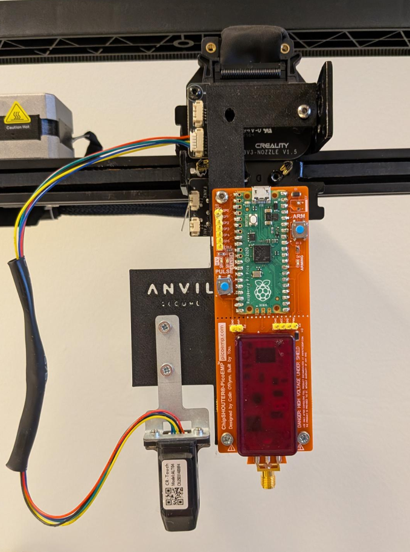
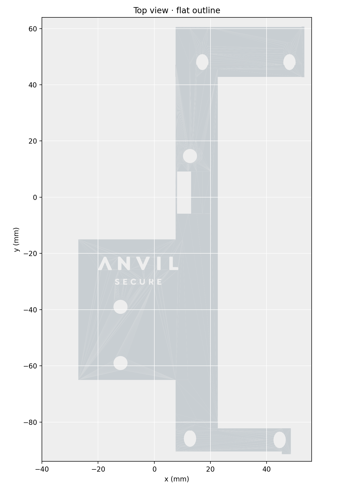
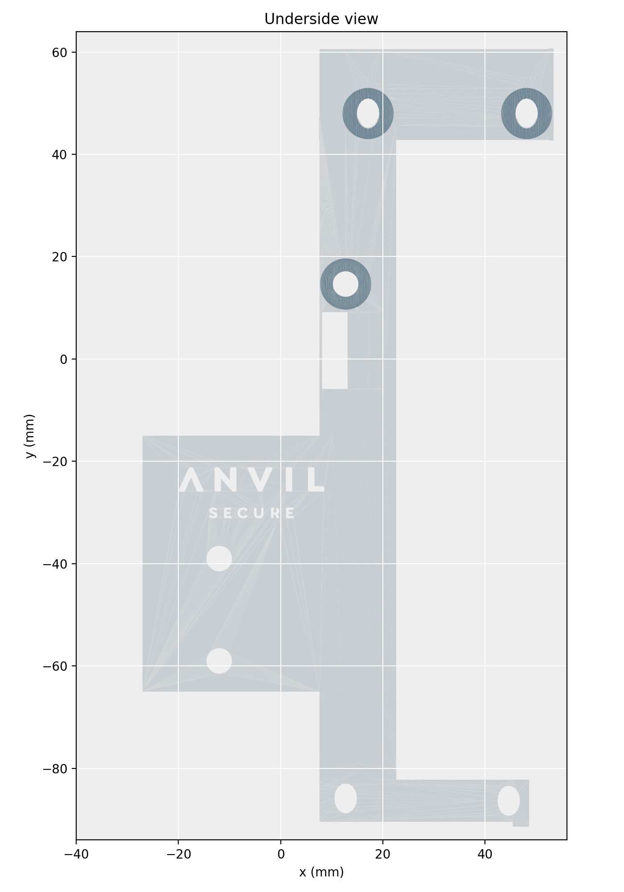

# PicoEMP Mount Extension for Creality Ender-3 V3 SE

A 3D-printable mount that holds a NewAE PicoEMP on a Creality Ender-3 V3 SE, so the printer's X/Y/Z stage can position the PicoEMP's coil over a target.

| File | Description |
| --- | --- |
| `CE3V3SE_picoemp-mount-extension-anvil.stl` | The mount, ready to slice. About 80 × 152 × 13 mm. |
| `images/top-view.png` | Flat outline of the part from above. |
| `images/underside-supports.png` | Underside view with the support rings around the screw holes. |

## What it is

The part is a single printed bracket (an "extension") that attaches the PicoEMP to the printer's moving head. It has:

- A long vertical bar, with arms at the top and bottom and a wider block at the lower left. Holes are spread across the arms and block.
- A rectangular cut-out in the bar, near its middle.
- Three underside support rings around three of the holes.

The file is a modified version of an earlier mount design. The modifications moved and aligned the holes, widened the upper bar, flattened protrusions, and rebuilt the underside supports.

## Why it exists

A PicoEMP produces short electromagnetic pulses to inject faults into a running chip (electromagnetic fault injection, or EMFI). Fault-injection experiments need the pulse to land at exactly the same spot, over and over, with a known step size. Hand-positioning the coil cannot do that.

The Ender-3 V3 SE already has a precise, motorized X/Y/Z stage, so this mount reuses it. The printer moves the coil, and the software controls the sweep. This makes repeatable positioning and systematic sweeps possible. The mount is the hardware half of that setup. The control software is a separate project that is not included in this repo.

## Usage

1. Open the STL in your slicer and check that it fits the build plate.
2. Make sure the underside support rings around the three holes are generated, as shown in the underside view.
3. Print the part and fasten it to the printer through its holes.
4. Check clearances on your own rig before running any motion. Keep the printer's physical emergency stop within reach.

## Safety and responsible use

- The mount moves a coil over hardware. Check that nothing can collide with the printer, the target, or cables before any motion.
- Use this only on hardware you own or are authorized to test. This setup is intended for security research, education, and defensive testing.
- The part is a mechanical fixture only. It does not include the PicoEMP, the controller software, or any firmware.

## Notes

- Dimensions come from the STL file. Verify them in your slicer before printing.
- The support-ring description is based on the preview images. Check the underside view in your slicer.

## License

The STL design and images are released under the [MIT License](LICENSE). The Anvil Secure name and logo are not covered by this licence.
